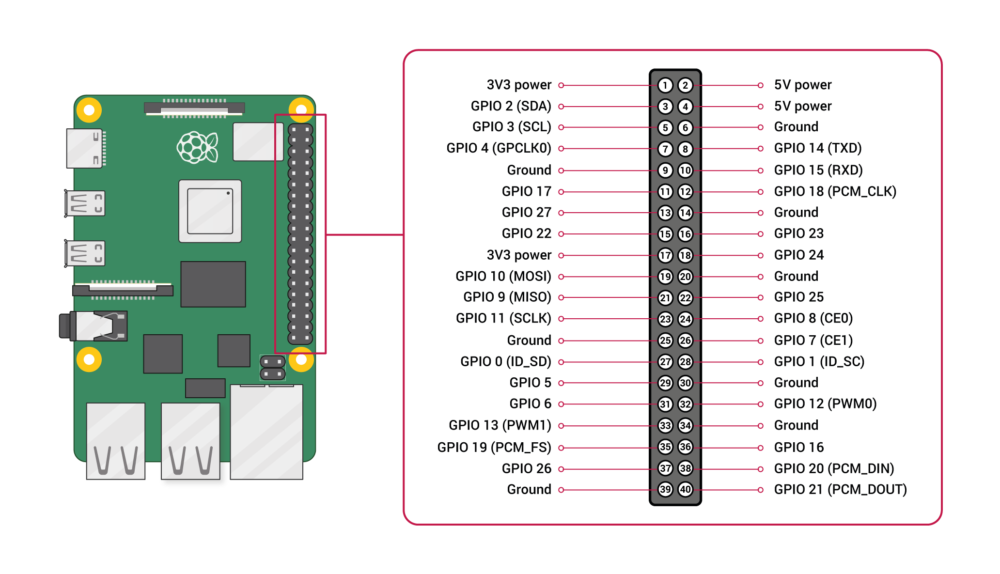
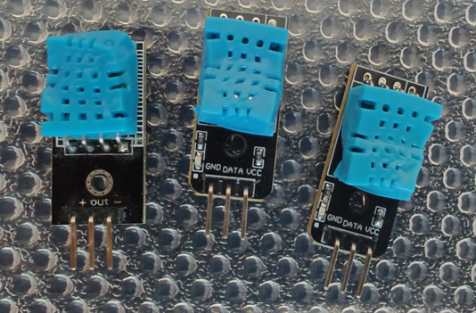
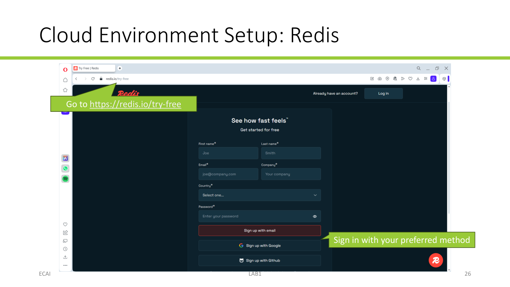
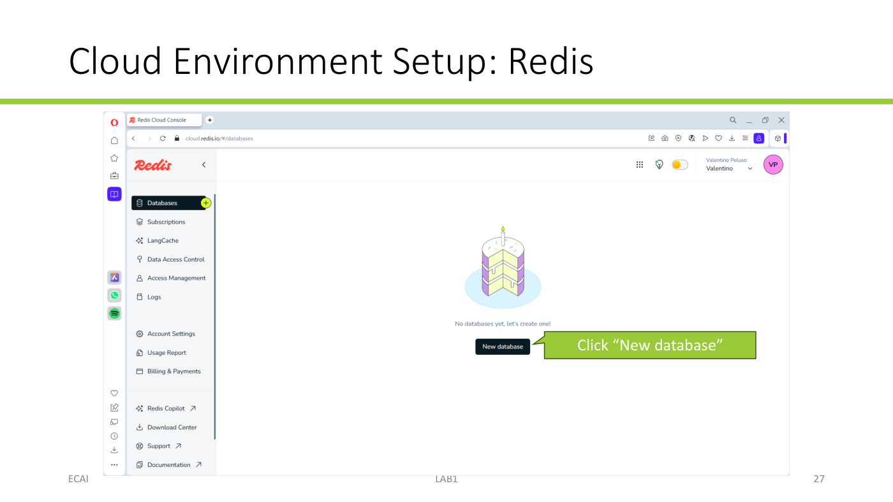
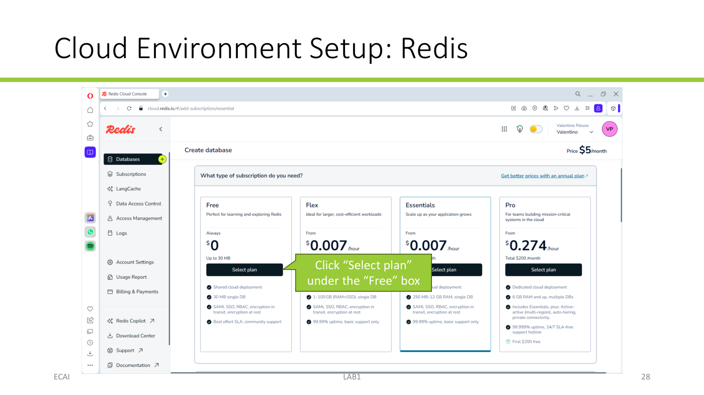
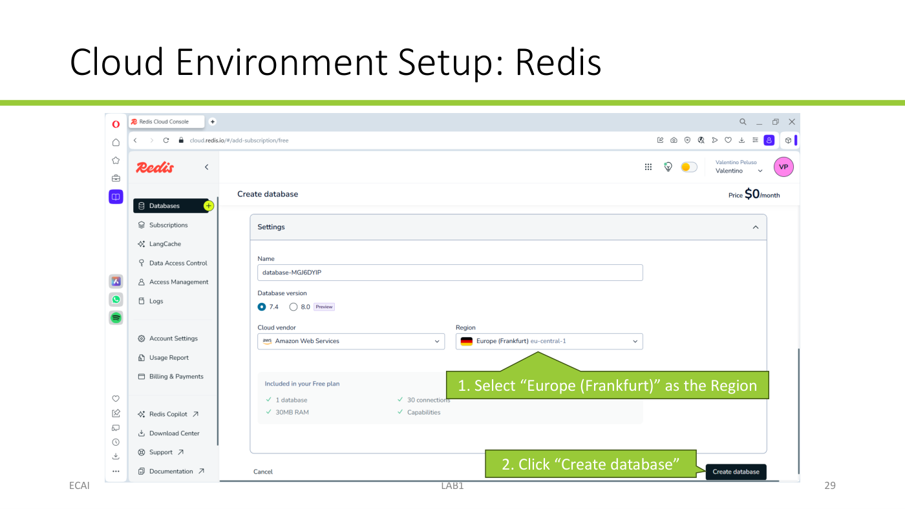
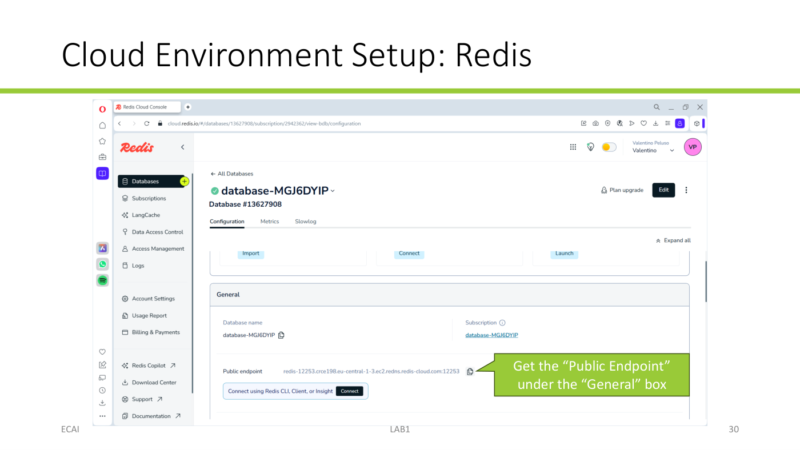
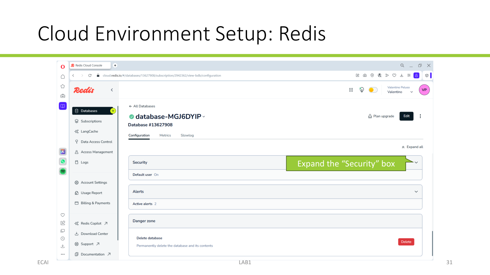
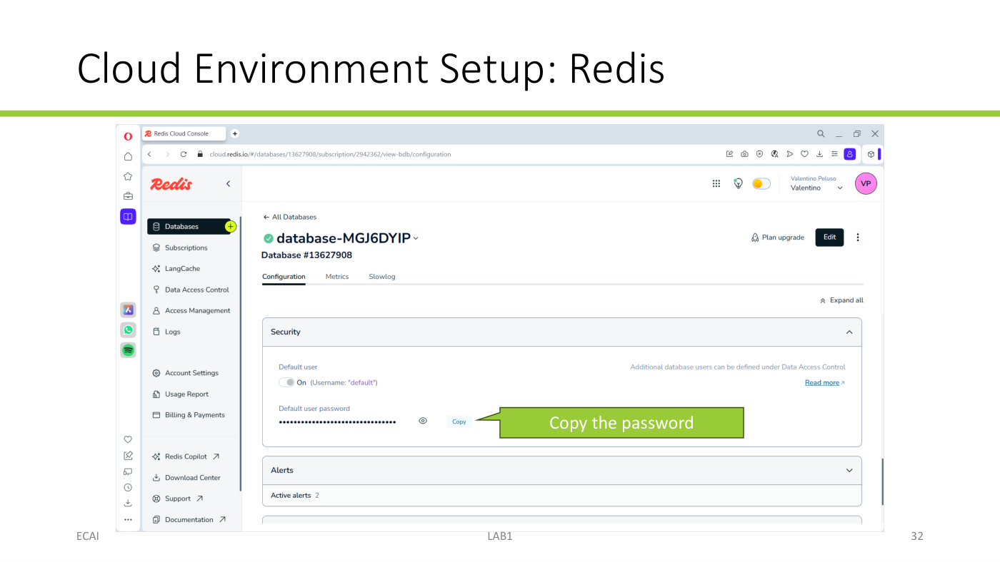

## Learning objectives

With the following exercises, you will learn:

- how to connect the DHT-11 sensor to the Raspberry Pi (RPI);
- how to measure temperature and humidity with Python code;
- how to store collected data in a cloud database;
- how to visualize historical data with a cloud dashboard.

## 0. Preparation

### RPI setup

With the RPI detached from the power supply, connect the DHT-11 sensor to the RPI (refer to the schematic below):

- Connect the VCC (+) pin of the DHT-11 to the 3V3 pin of the RPI (pin 1 in the figure).
- Connect the DATA (out) pin of the DHT-11 to the GPIO 4 pin of the RPI (pin 7).
- Connect the GND (-) pin of the DHT-11 to the Ground pin of the RPI (pin 6).



:::{.callout-warning}
Wrong connections will damage the sensor! Check the pinout before connecting the RPI to the power supply.
:::

**Fried sensors from past years:**

{width=25%}

- After double-checking the connections, connect the RPI to the power supply.

### Cloud setup: Redis Cloud

Create a Redis Cloud database to store the sensor readings:

1. Go to [redis.io/try-free](https://redis.io/try-free) and sign in using your preferred method.

   {width=75%}

2. Click **New database**, choose the **Free** plan, select **Europe (Frankfurt)** as the region, and click **Create database**.

   {width=75%}

   {width=75%}

   {width=75%}

3. After the database is created, find the **Public Endpoint** under **General**. It contains the host and port separated by a colon; save both values for the Python client.

   {width=75%}

4. Expand **Security** and copy the default user's password. The username is `default`.

   {width=75%}

   {width=75%}

Keep the database host, port, and password available for the next exercises.

## 1. Temperature/humidity measurement

On the RPI, create a new Python file and write a script that uses the `adafruit_dht` module to read temperature and humidity from the DHT-11 sensor.

Every 2 seconds, print the T/H values using the following format:

```text
year-month-day hour:minute:second.microseconds - mac_address:temperature = T
year-month-day hour:minute:second.microseconds - mac_address:humidity = H
```

where `mac_address` is the MAC address of your network card, `T` is the temperature value in degrees Celsius, and `H` is the humidity value in %RH.

Example:

```text
2022-10-01 19:21:51.699254 - a4:bb:6d:12:34:56:temperature = 21
2022-10-01 19:21:51.699254 - a4:bb:6d:12:34:56:humidity = 60
2022-10-01 19:21:53.701326 - a4:bb:6d:12:34:56:temperature = 22
2022-10-01 19:21:53.701326 - a4:bb:6d:12:34:56:humidity = 59
```

Hints:

- Import the modules and the board pin used by the sensor:

  ```python
  import adafruit_dht
  import uuid
  import time
  from datetime import datetime
  from board import D4
  ```

- Use `uuid.getnode()` to get the network card address, then format it as six two-digit hexadecimal numbers separated by colons.

  ```python
  mac = uuid.getnode()
  mac_address = ':'.join(f'{(mac >> i) & 0xff:02x}' for i in range(40, -1, -8))
  ```

- Create the DHT-11 device object on the GPIO pin connected to the DATA wire:

  ```python
  dht_device = adafruit_dht.DHT11(D4)
  ```

- Use `datetime` and `strftime` with the format `'%Y-%m-%d %H:%M:%S.%f'` to create the formatted date and time:

  ```python
  timestamp = time.time()
  formatted_datetime = datetime.fromtimestamp(timestamp).strftime('%Y-%m-%d %H:%M:%S.%f')
  ```

- Read the T/H values using the two corresponding properties of the `dht_device` object:
  ```python
  temperature = dht_device.temperature
  humidity = dht_device.humidity
  ```

- Put sensor reading code inside a `try` block to handle possible sensor-RPI connection failures. Try to restore the connection by reinitializing the sensor object after a read failure:

  ```python
  try:
      ...
  except:
      dht_device.exit()
      dht_device = adafruit_dht.DHT11(D4)
  ```

- Put the read-and-print steps inside a `while True` loop and use `time.sleep(2)` to take a reading every 2 seconds.

## 2. Data storage

### Introduction to Redis

Redis is an in-memory NoSQL database. Data is stored as key-value pairs: a key is a string that identifies a record, and its value contains the associated data. For example, the Redis commands below store and retrieve a value:

```text
SET message "Hello World!"
GET message
```

Because data resides in memory (RAM), Redis provides fast read and write access, which is useful for real-time IoT applications. Redis also supports a dedicated data structure for time series: **RedisTimeSeries**.

A RedisTimeSeries is a sequence of samples associated with a name. Each sample contains a Unix timestamp in milliseconds and a numeric value. A Unix timestamp is the time elapsed since midnight on January 1, 1970. For example:

```text
TS.CREATE temperature
TS.ADD temperature 1652824475581 25.3
```

### Python API

`redis-py` is the official Python client for Redis. It provides a Python interface for reading and writing Redis data, including time series.

#### Connect to the Redis database

Create a Redis client using the host, port, username, and password from your Redis Cloud database:

```python
import redis
import time

REDIS_HOST = "your-database-host"
REDIS_PORT = 12345  # use the port from your public endpoint
REDIS_USERNAME = "default"
REDIS_PASSWORD = "your-database-password"

redis_client = redis.Redis(
    host=REDIS_HOST,
    port=REDIS_PORT,
    username=REDIS_USERNAME,
    password=REDIS_PASSWORD,
)

is_connected = redis_client.ping()
print("Redis Connected:", is_connected)
```

Replace the example host, port, and password with the values for your database. Do not publish your database password.

#### Store data

Create two time series, one for temperature and one for humidity. Use the sensor MAC address as part of each time-series name. Generate a Unix timestamp in milliseconds for each sample, then add the reading to its time series:

```python
timestamp_ms = int(time.time() * 1000)

redis_client.ts().add(
    f"{mac_address}:temperature", timestamp_ms, temperature
)
redis_client.ts().add(
    f"{mac_address}:humidity", timestamp_ms, humidity
)
```

The first `add` for each name creates the time series if it does not already exist.

#### Read data

To read time-series data from a Redis database, use the range command:

```python
redis_client.ts().range(key, from_timestamp, to_timestamp)
```

- `key` is the name of the time series.
- `from_timestamp` is the start of the range, as a Unix timestamp in milliseconds, or `-` to use the earliest sample.
- `to_timestamp` is the end of the range, as a Unix timestamp in milliseconds, or `+` to use the latest sample.

### Inspect data with Redis Insight

Redis Insight is the official, free, cross-platform graphical interface for exploring and querying Redis databases. It is useful for checking that your script is writing data correctly and for debugging the database contents.

Download and install [Redis Insight](https://redis.io/downloads/#Redis_Insight), then connect it to your Redis Cloud database using the public endpoint and database credentials. Open the database in Redis Insight and check that the two time series contain new samples as your RPI script runs.

### Exercises

#### Exercise 1: Store T/H data in Redis

1. On your Raspberry Pi, update the temperature/humidity data collection script to send data to Redis instead of printing it.
2. Connect to your Redis database using the `redis-py` library.
3. Create two RedisTimeSeries to store your sensor readings: `{mac_address}:temperature` and `{mac_address}:humidity` (e.g., `a4:bb:6d:12:34:56:temperature` and `a4:bb:6d:12:34:56:humidity`).
4. Modify the data collection loop to read temperature and humidity from the DHT-11 every 2 seconds and add each reading to the corresponding time series.
5. Run your script and verify that data is being inserted into Redis using Redis Insight.

:::{.callout-note}
Traffic from Raspberry Pi to Redis is blocked on the eduroam Wi-Fi network. To successfully complete this exercise in the lab, connect your Raspberry Pi to a mobile hotspot using your smartphone.
:::

#### Exercise 2: Visualize T/H data from Redis in Deepnote

Create a Deepnote notebook that:

1. Connects to your Redis database.
2. Retrieves the time-series temperature and humidity readings collected by your Raspberry Pi. 
    - Note: Deepnote has a different time zone than ours.
3. Visualizes the readings using a line chart, with temperature and humidity on the y-axis and time on the x-axis.
