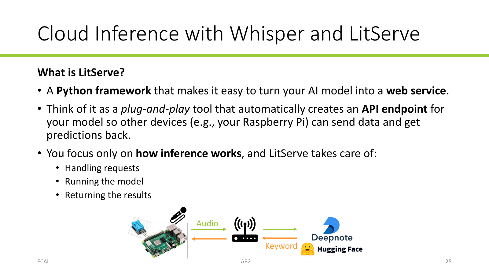
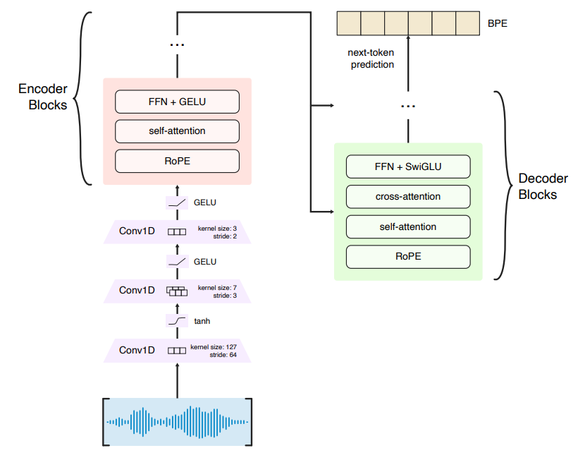

## Introduction

A voice user interface (VUI) processes speech to identify commands that change the state of a system or trigger an action. A VUI can first use **automatic speech recognition (ASR)** to convert speech to text, then process the text to infer the user's intent. This lab focuses on ASR with pretrained models; intent classification is covered in the next lab.

In this lab, you will record audio with a USB microphone and compare two ways to run ASR: cloud-based ASR (using OpenAI Whisper) running on Deepnote and edge-based ASR (using Moonshine) running on the Raspberry Pi.

## Learning objectives

- Learn to record audio from a USB microphone with Python;
- Learn to implement and use a cloud inference service;
- Learn to run streaming ASR on an embedded system;
- Compare and evaluate cloud and edge inference responsiveness.

## 0. Preparation

Connect the microphone to the RPI.

For recording, we will use the `sounddevice` Python library.
Check that the microphone is available to `sounddevice`:

```bash
python -c "import sounddevice as sd; print(sd.query_devices())"
```

Note the device index for the USB microphone. You will use it when opening a recording stream.

## 1. Audio recording with Python

### Exercise: Record audio with the RPI and USB microphone

In VS Code, create a Python script that records audio from the USB microphone. Use `sounddevice.InputStream` and stop the recording when the **Q** key is pressed. Save one-second audio blocks as WAV files while recording, using the timestamp as each filename. The expected output is a sequence of one-second WAV files that you can play back to check the recording.

### Hints

- Import the packages and functions used to record and save audio:

  ```python
  import os
  import sounddevice as sd
  from time import time
  from scipy.io.wavfile import write
  ```

- Define a stream callback to save the recording on disk. A stream callback is called by `sounddevice` as each audio block arrives. The callback must accept four arguments defined by the API:
  - `indata` contains the input samples for the current block;
  - `frames` is the number of audio frames in the block;
  - `callback_time` contains the timing information for the audio block;
  - `status` reports audio input/output issues, such as an input overflow.

  In this exercise, use `indata` to save each block. Set `store_audio` to `True` before starting the stream.

  ```python
  def callback(indata, frames, callback_time, status):
      global store_audio

      if status:
          print(f'Audio status: {status}')

      if store_audio:
          timestamp = time()
          filename = f'{timestamp}.wav'
          write(filename, 48000, indata)
          filesize_in_kb = os.path.getsize(filename) / 1024
          print(f'Size: {filesize_in_kb:.2f} KB')
  ```

- `sd.InputStream` opens the microphone and calls `callback` periodically. The main `sd.InputStream` arguments are:
    - `device`: select the microphone device;
    - `channels`: the number of microphone channels (e.g., 1 for mono, 2 for stereo);
    - `dtype`: the number of bits used to represent each recorded sample;
    - `samplerate`: the sampling frequency in Hz; this example uses 48 kHz;
    - `blocksize`: the number of frames in each block passed to the callback.

  ```python
  store_audio = True

  with sd.InputStream(
      device=1,  # replace with the USB microphone's device index
      channels=1,
      dtype='int32',
      samplerate=48000,
      blocksize=48000,
      callback=callback,
  ):
      while True:
          key = input('Press Q to stop or P to pause/resume saving: ')
          if key in ('q', 'Q'):
              print('Stop recording.')
              break
          if key in ('p', 'P'):
              store_audio = not store_audio
  ```

  The `with` statement keeps the stream open while its indented block runs and closes it when the block ends. The callback runs as audio arrives in a separate thread, while `input()` waits for a key in the main thread. Press **P** to pause or resume saving audio; press **Q** to stop the stream.

For more information, see the [`sounddevice.InputStream` documentation](https://python-sounddevice.readthedocs.io/en/0.4.5/api/streams.html) and the [`scipy.io.wavfile.write` documentation](https://docs.scipy.org/doc/scipy/reference/generated/scipy.io.wavfile.write.html).

## 2. Cloud-based ASR

### Whisper

Whisper is a speech-recognition model developed by OpenAI. It is available in different sizes; we will use the English-only `openai/whisper-tiny.en` variant.

Whisper expects mono audio sampled at **16 kHz**. Before inference, a processor converts the waveform into a **log-Mel spectrogram**. The model then predicts text-token IDs, which the processor decodes into readable text.

The following code illustrates the main steps for running inference with Whisper. Here, `audio_16k` is a mono waveform sampled at 16 kHz.

```python
from transformers import WhisperForConditionalGeneration, WhisperProcessor

model_name = 'openai/whisper-tiny.en'

# Initialize the processor. It handles preprocessing (feature extraction and post-processing (token decoding)
processor = WhisperProcessor.from_pretrained(model_name)

# Initialize the model
model = WhisperForConditionalGeneration.from_pretrained(model_name)

# Convert the raw waveform to log-Mel spectrogram
input_features = processor(
    audio_16k,
    sampling_rate=16000,
    return_tensors='pt',
).input_features

# Predict token IDs
predicted_ids = model.generate(input_features)

# Decode the tokens into readable text
transcription = processor.batch_decode(
    predicted_ids, skip_special_tokens=True
)[0]
```

### Serving Whisper with LitServe

We will deploy Whisper on Deepnote using **LitServe**, a Python framework for exposing an AI model as a web service. LitServe creates an API endpoint that can receive audio through a HTTP request and return the model's transcription.

{width=90%}

The Raspberry Pi sends audio to the service through an HTTP request and receives the transcription in the response. The measured request time includes communication between the RPI and the cloud, as well as inference on the server.

### Exercise: Cloud-based ASR

1. Download the script [`4.2-tts_api.py`](../assets/downloads/4.2-tts_api.py) and the notebook [`Lab2 - Cloud Inference Server.ipynb`](../assets/downloads/Lab2%20-%20Cloud%20Inference%20Server.ipynb){download="4.3 - Lab2 - Cloud Inference Server.ipynb"}.
2. Upload the two files to a private Deepnote project and open  notebook in that project.
3. Start the notebook's machine and turn **Incoming connections** on in its settings. Copy the API address, which is the address you will use from the Raspberry Pi side for sending audio data.
4. Run the notebook to start the serve and leave it running.
5. In your Raspberry Pi, modify the callback of the recording script to send recorded data to the Cloud API. Use `time()` to measure the round-trip time.
6. Run the script and evaluates how it works.


### Hints

- Import the required packages:
  ```python
  import base64
  import numpy as np
  from scipy.io.wavfile import read
  from scipy.signal import resample_poly
  ```

- The recording procedure returns a 2D array (channels $\times$ samples) with 48-kHz `int32` samples. However, Whisper requires one-dimensional 16-kHz `float32` inputs. Before sending data, reshape the audio array, convert the recording to `float32`, and downsample it to 16 kHz.

  ```python
  sample_rate = 48000
  audio_mono = audio.reshape(-1)
  audio_float32 = audio_mono.astype(np.float32) / (2**31)
  audio_16k = resample_poly(audio_float32, up=16000, down=sample_rate)
  encoded = base64.b64encode(audio_16k.tobytes()).decode('ascii')
  sampling_rate = 16000
  ```

- The API expects a JSON object containing the audio as base64-encoded `float32` samples in the `input` field and the sample rate in the `sampling_rate` field. Use `requests.post` to send this JSON object.

- Measure the round-trip time by calling `time()` immediately before the request and after the response arrives.

  ```python
  import requests
  from statistics import median, stdev
  from time import sleep, time

  start = time()
  try:
      response = requests.post(
          API_URL,
          json={'input': encoded, 'sampling_rate': sampling_rate},
      )
      response.raise_for_status()
      prediction = response.json()['output']
      print(f'Prediction: {prediction}')
      elapsed_ms = (time() - start) * 1000
      print(elapsed_ms)
      print(f'Round-trip time: {elapsed_ms:.1f} ms')
  except requests.exceptions.ConnectionError as e:
      print(f'Connection failed: {e}')
  except requests.exceptions.HTTPError as e:
      print(f'HTTP error occurred: {e}')
  except requests.exceptions.RequestException as e:
      print(f'An error occurred: {e}')
  ```

## 3. Edge-based ASR with Moonshine

Moonshine is a family of speech-recognition models designed for live transcription and voice commands. It is an encoder-decoder Transformer that uses an audio front end based on learned 1D convolution layers to process the raw waveform and Rotary Positional Embeddings for efficient self-attention.

{width=80%}

The `moonshine-voice` Python package provides a `MicTranscriber` class that captures microphone audio and streams transcription updates. On the first call to its `load()` method, the package downloads the model weights.

`MicTranscriber` provides two callbacks:

- `on_text` receives partial text that may change while you are speaking;
- `on_line` receives each completed line, including its final transcription latency.

### Exercise: Transcribe speech with `MicTranscriber`

Create a Python script on the Raspberry Pi that prints partial text while you speak and each completed line in the terminal.

```python
import time
from moonshine_voice import MicTranscriber, ModelArch


def show_partial(text):
    print(f'\r{text}', end='', flush=True)


def show_line(line):
    print(f'\r{line.text}')
    print(f'Finalization latency: {line.last_transcription_latency_ms} ms')


mic = (
    MicTranscriber()
    .language('en')
    .model_arch(ModelArch.TINY_STREAMING)
    .on_text(show_partial)
    .on_line(show_line)
)

mic.load()
with mic:
    mic.start()
    try:
        while True:
            time.sleep(0.1)
    except KeyboardInterrupt:
        mic.stop()
```

The `time.sleep()` call keeps the main thread alive.

Try several short commands and longer sentences. Record the finalization latency and note when partial text first appears. Make a qualitative comparison between Cloud vs. Edge ASR and discuss the advantages of Edge AI.

## Further readings

- [Whisper model card](https://huggingface.co/openai/whisper-tiny.en)
- [Whisper research paper](https://arxiv.org/abs/2212.04356)
- [LitServe documentation](https://lightning.ai/docs/litserve/home)
- [Moonshine: Speech Recognition for Live Transcription and Voice Commands](https://arxiv.org/abs/2410.15608)
- [Moonshine v2: Ergodic Streaming Encoder ASR for Latency-Critical Speech Applications](https://moonshine-voice.readthedocs.io/en/latest/models/papers/)
- [Moonshine Voice Python quickstart](https://moonshine-voice.readthedocs.io/en/latest/quickstart/)
- [Moonshine Voice API reference](https://moonshine-voice.readthedocs.io/en/latest/api/classes/)
